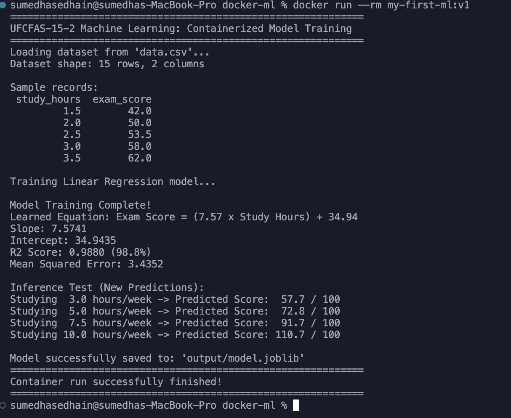
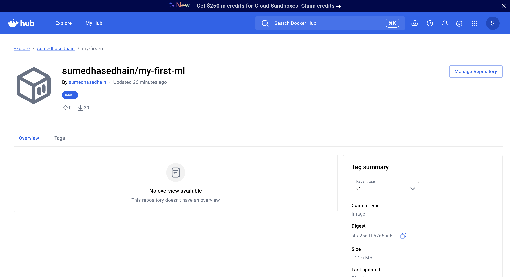
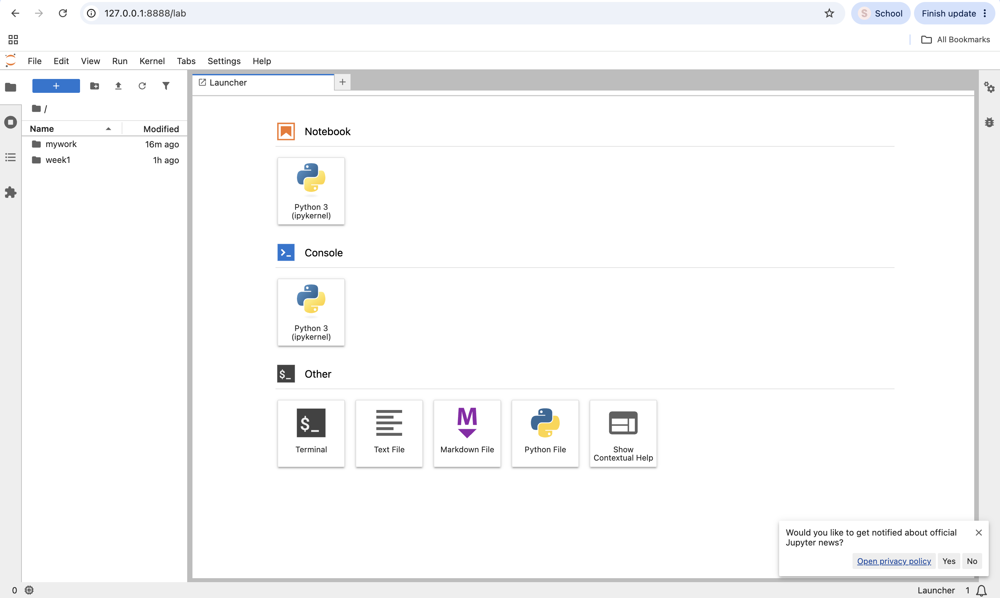

# Week 1 · Day 2: Docker ML Lab Verification

**Student Name:** Sumedha Sedhain  
**Student ID:** 11304  
**Docker Hub Repository:** https://hub.docker.com/r/sumedhasedhain/my-first-ml

## 1. Local Training Output

- **Learned Equation:** Exam Score = (7.57 × Study Hours) + 34.94
- **R² Score:** 0.9880
- **Mean Squared Error:** 3.4352

The Linear Regression model was successfully trained using a dataset of 15 records to predict exam scores based on study hours.

### Training Output Screenshot

## 2. Verification Screenshot / Terminal Proof

### 2.1 Docker Hub Repository

Successfully pushed the custom ML Docker image `sumedhasedhain/my-first-ml:v1` to Docker Hub.

### 2.2 Lecturer's Docker Image

Successfully pulled the official course image using:

`docker pull alkimi/ml:week1`

This image provides a preconfigured environment for Machine Learning exercises.

### 2.3 JupyterLab Verification

Successfully launched JupyterLab using the lecturer's Docker image and accessed it through `localhost:8888`.

## 3. Reflection

This lab provided practical experience with Docker containerization for Machine Learning. I learned how to build and run a Docker image, package Python dependencies, train a Linear Regression model, push an image to Docker Hub, and use a preconfigured JupyterLab environment.
